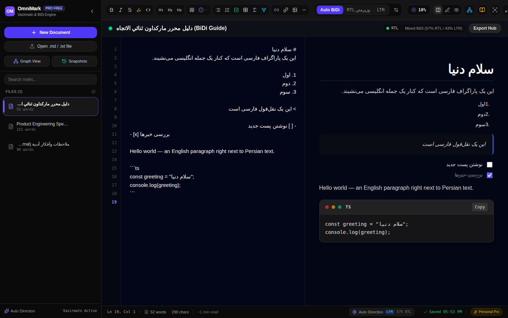

# OmniMark — Premium BiDi Markdown Editor

[](https://github.com/shadowcerdic/markdowneasy/actions/workflows/ci.yml)
[](LICENSE)
[](https://react.dev)
[](https://vite.dev)

A high-performance Markdown editor with intelligent auto-direction (RTL/LTR),
live synchronized preview, focus mode, and a multi-document workspace.

**Try it live:** https://shadowcerdic.github.io/markdowneasy/

Persian/Arabic and English each keep their own direction — per block, per
list item, per table cell — while code, math, and diagrams stay LTR.



## Contents

- [Quick start](#quick-start)
- [Features](#features)
- [Keyboard shortcuts](#keyboard-shortcuts)
- [Checks](#checks)
- [Deploying](#deploying)
- [Tech stack](#tech-stack)
- [Project layout](#project-layout)
- [Security notes](#security-notes)
- [Known limitations](#known-limitations)
- [Contributing](#contributing)
- [License](#license)

## Quick start

```bash
bun install     # or: npm install
bun run dev     # Vite dev server on http://localhost:3000
bun run build   # production build into dist/
bun run preview # serve the production build locally
```

No account, no server, no build step for the reader: open the live demo,
write, and everything is saved in your browser's `localStorage`.

## Features

- **BiDi auto-direction** — first-strong-character detection per block
  (`src/utils/bidi.ts`). Persian/Arabic-Indic digits, diacritics, and
  tatweel are correctly treated as neutral, not strong RTL, and inline
  code, links, and bare URLs are stripped before detection so they cannot
  fool it.
- **Live preview** — hand-rolled BiDi-aware Markdown renderer
  (`src/utils/markdownParser.ts`): headings, lists, task lists, tables,
  callouts, fenced code, Mermaid diagrams, inline math, wiki links, tags.
- **Workspace** — multiple documents, snapshots, outline, knowledge graph,
  tags, find & replace, writing goals, readability stats.
- **Export** — standalone HTML, clean Markdown (+ YAML frontmatter), plain
  text, rich-text clipboard copy, print/PDF.
- **Persistence** — documents auto-save to `localStorage` (debounced,
  flushed on tab hide/unload, with a visible error banner if the write
  fails). Corrupt saved data is quarantined instead of crashing the app.
- **Focus & typewriter modes**, dark theme, Vazirmatn for Persian text.

## Keyboard shortcuts

| Shortcut | Action |
|---|---|
| `Ctrl/Cmd + S` | Save now (flush pending autosave) |
| `Ctrl/Cmd + B` / `I` | Bold / italic |
| `Ctrl/Cmd + E` | Inline code |
| `Ctrl/Cmd + F` | Find & replace |
| `Ctrl/Cmd + Shift + X` | Flip document direction (Auto / RTL / LTR) |

## Checks

```bash
bun run lint    # tsc --noEmit
bun run test    # node:test suite (BiDi engine, parser, stats)
```

CI (`.github/workflows/ci.yml`) runs install → lint → test → build on every
push and pull request.

## Deploying

The app is a static Vite build (`dist/`), so it runs on any static host.
This repo ships a GitHub Pages workflow (`.github/workflows/deploy.yml`):
every push to `main` builds and publishes to
https://shadowcerdic.github.io/markdowneasy/.

The build uses a relative base (`base: './'` in `vite.config.ts`), so the
same output also works under any other subpath — Cloudflare Pages, Netlify,
Vercel, or any static file server — with no config change. If you deploy to
a host of your own, serve `dist/` and set the `frame-ancestors 'none'`
header (the app's CSP meta tag cannot set it).

## Tech stack

React 19 · Vite 8 · TypeScript · Tailwind CSS 4 · Mermaid · DOMPurify ·
html2pdf.js · node:test + tsx

## Project layout

```
src/
  App.tsx                 workspace state, persistence, shortcuts
  components/             EditorArea, PreviewArea, Toolbar, Sidebar, modals…
  utils/
    bidi.ts               direction detection + BiDi stats
    markdownParser.ts     Markdown → BiDi-aware HTML
    markdownStats.ts      word counts, outline
    exporter.ts           HTML/Markdown/text/PDF export
    readability.ts tags.ts wikiLinks.ts
  data/defaultDocuments.ts
.github/workflows/
  ci.yml                  install → lint → test → build
  deploy.yml              build → GitHub Pages (on push to main)
docs/
  screenshot.png          README screenshot
```

## Security notes

- Preview HTML is rendered with `dangerouslySetInnerHTML`, so it is defended
  in two layers: the parser escapes text and allowlists link/image URL
  schemes (`http/https/mailto`, relative, `#`; raster `data:` images only)
  and fenced-code languages, and `PreviewArea` additionally sanitizes the
  output with DOMPurify.
- Mermaid runs with `securityLevel: 'strict'` and is dynamically imported
  (it is not in the initial bundle).
- Document titles are escaped in every export path (standalone HTML, rich
  text, PDF container).
- `index.html` and exported HTML carry a Content-Security-Policy.
- No secrets are needed at runtime: `@google/genai` is currently unused
  (the AI Studio Gemini capability in `metadata.json` is not wired up —
  do not put a Gemini key in client code; it would ship in the bundle).

## Known limitations

- The parser is hand-rolled, not CommonMark: no nested lists, no setext
  headings, no footnotes, no `<details>` blocks, no reference-style links,
  no autolinking, no raw-HTML blocks.
- Find & Replace highlights nothing (`onHighlightMatches` is a no-op) and
  "Replace" acts on the first match in the document, not the "current" one.
- Vazirmatn is loaded from Google Fonts at runtime; if that CDN is
  unreachable (notably from Iran), Persian falls back to the system font
  with no warning. Self-hosting the font is the planned fix.
- Word counts include code blocks and frontmatter; CJK text is undercounted
  (consecutive CJK characters count as one "word").
- Documents live only in the browser's `localStorage` (~5 MB quota, no
  sync, no encryption). Export backups regularly.

## Contributing

Issues and pull requests are welcome. Please run `bun run lint` and
`bun run test` before opening a PR, and keep the honest limitations list
above up to date when a fix lands.

## License

Apache-2.0 — see `LICENSE`.
